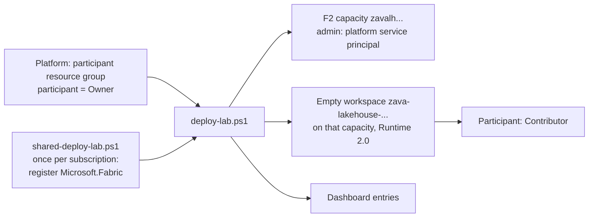

# Lab automation: an empty Fabric workspace per participant

This folder makes the Zava Lakehouse Bootcamp deployable by the MicroHack platform. It follows the
[MicroHack lab automation contract](https://github.com/microsoft/MicroHack/blob/main/99-MicroHack-Template/labautomation/README.md).
The platform publishes neither this folder nor its files to participants or coaches.

Before the session, every participant receives **their own empty Fabric workspace on their own
dedicated, Active F2 capacity**. Several participants share one Azure subscription; each has their
own resource group, capacity and workspace. Nothing else is created: Challenge 1 creates the
lakehouse, uploads, notebooks and pipeline from the empty workspace, as the labs require.

| File | Purpose |
| --- | --- |
| `lab-defaults.json` | Platform settings: resource-group scope, 5 labs per subscription, licenses, regions, cost, quality and content preparation. |
| `shared-deploy-lab.ps1` | Once per subscription, before any lab: registers `Microsoft.Fabric` and logs a quota pre-flight. Creates nothing and emits no credentials. |
| `deploy-lab.ps1` | Once per participant: capacity, workspace, workspace role and dashboard entries. |
| `main.bicep` | The participant's `Microsoft.Fabric/capacities` resource (F2). |
| `fabric-lab-helpers.ps1` | Functions both hooks dot-source: REST calls with throttling and long-running operations, provider, capacity and workspace helpers. |

The hooks use only PowerShell 7 and Az PowerShell, which the platform runner provides. They need no
Python, module installation or Azure CLI extension.

## What each participant gets



1. **Resource group**, created by the platform. The participant is Owner of it and Reader on the
   subscription, which lets them see their capacity's state in Azure.
2. **Fabric capacity** `zavalh<hash>`, SKU F2, in the first preferred region that offers F2. Its only
   capacity administrator is the deploying identity, the platform service principal, by object ID.
   Participants are not capacity administrators.
3. **Fabric workspace** `zava-lakehouse-<lab user>-<hash>`, empty, assigned to that capacity, with the
   Spark runtime on 2.0 as the lab specification assumes. The platform service principal is its Admin
   because it created it. The participant is **Contributor**: enough to create and run the lakehouse,
   OneLake files, notebooks, notebook jobs, the pipeline and the optional semantic model, but not to
   change workspace access or settings. The workspace description names the event, participant,
   capacity, resource group and subscription.
4. **Dashboard entries**, emitted only after all of the above succeeded:

| Name | Value |
| --- | --- |
| `Fabric workspace` | Workspace name; participants paste it where a lab prompt says `<assigned workspace name>`. |
| `Fabric workspace URL` | `https://app.fabric.microsoft.com/groups/<workspace ID>` |
| `Fabric workspace role` | `Contributor` |
| `Fabric capacity` | Capacity name |
| `Fabric capacity SKU` | `F2` |
| `Fabric capacity region` | Region as Fabric shows it, for example `Sweden Central` |
| `Lab Resource Group` | Only for `deploymentType: subscription`, where the platform shows no resource group itself. |

The platform adds its own entries, such as `Resource Group Name`, `Subscription ID` and the lab
account's sign-in details. The participant content refers to these names, so keep them in sync if
you rename one.

### Deployment flow

`deploy-lab.ps1` runs once per participant, in parallel:

1. Validates its inputs in the script body. The param block matches the platform contract exactly.
2. Reads the deploying identity's object ID from the `oid` claim of its own ARM token, with no
   Microsoft Graph call, and stops if that identity is also a participant.
3. Re-checks that `Microsoft.Fabric` is registered, registering it only if the shared hook did not.
4. Keeps the preferred regions whose `Microsoft.Fabric/skus` list offers F2, with a warning for each
   region it skips.
5. Deploys `main.bicep` with `Invoke-MhhDeploymentWithRegionFallback`, passing the participants as
   `-RgOwnerEntraObjectIds` so they keep Owner if the helper recreates the resource group.
6. Waits until the capacity is Active, then finds its Fabric capacity ID through `GET /v1/capacities`.
7. Creates or reuses the workspace (`POST /v1/workspaces` with `capacityId`), assigns it to the
   current capacity, checks the Spark runtime and grants the Contributor role.
8. Emits the dashboard entries.

Every REST call first refreshes the platform credential with `Update-MhhToken`. Calls retry `429` and
`5xx` responses after `Retry-After`, or with jittered backoff when no header is sent. They follow
Fabric `202` + `Location` long-running operations, page through `continuationUri` and `nextLink`,
and send tokens only to `management.azure.com` and `api.fabric.microsoft.com`. Every wait is bounded.

### Names and reruns

- Workspace names are unique across the tenant, and workspaces outlive the resource group. The
  workspace name hashes the event's group name (`Get-MhhGroupName`) with the participant's object ID.
  A rerun in the same event finds and reuses its own workspace. A later event in the same
  subscription computes a different name, so it never inherits an earlier participant's workspace.
- The capacity name hashes the event, subscription, resource group and participant, and satisfies
  the Fabric rule `^[a-z][a-z0-9]{2,62}$`.
- Every step converges rather than duplicating. An existing capacity is updated in place, and a
  paused one is resumed first. An existing workspace is reused and moved to the current capacity if
  region fallback recreated it. A runtime other than 2.0 is reset. An existing role assignment is
  checked and corrected, never added twice.

## Prerequisites

### Fabric tenant settings

A Fabric administrator sets these in **OneLake catalog > Govern > Configurations > Tenant settings**.
Changes can take up to 15 minutes to apply.

| Setting | Enable for | Needed by |
| --- | --- | --- |
| **Service principals can call Fabric public APIs** (Developer settings) | A security group that contains the platform service principal | `deploy-lab.ps1`: capacities, workspaces, role assignments |
| **Service principals can create workspaces, connections, and deployment pipelines** (Developer settings; off by default for new tenants) | The same group | `deploy-lab.ps1`: `POST /v1/workspaces` |
| **Create workspaces** (Workspace settings), if your tenant restricts it | The same group | `deploy-lab.ps1`: `POST /v1/workspaces` |
| **Users can create Fabric items** (Microsoft Fabric) | Lab users | Challenge 1: lakehouse, notebooks and pipeline |
| **Users can access data stored in OneLake with apps external to Fabric** (OneLake settings) | Lab users | Challenge 1 uploads the CSVs from the participant's machine through the OneLake APIs |

For the optional challenges:

- **Challenge 5, Project Osmos:** **Users can use Copilot and other features powered by Azure
  OpenAI**. **Users can use Copilot, AI Agents, and other AI experiences powered by OpenAI as a
  Microsoft Subprocessor** is recommended. If the capacity region has no OpenAI service, the
  cross-geo processing and storage settings are also needed. Challenge 5 also needs a second, fresh
  workspace with its own capacity, which this automation does not provision.
- **Challenge 6, semantic model and Fabric IQ:** the Fabric IQ MCP server needs a tenant home region
  that supports all Fabric workloads. Users must be able to consent to the delegated Power BI
  Service permissions `Item.Read.All` and `Item.Execute.All`; otherwise an administrator consents
  for them. The optional `powerbi-modeling-mcp` authoring route needs **Users can use the Power BI
  Model Context Protocol server endpoints (preview)**.

### Licenses (`groups`)

**`M365-E5-Users`** assigns Microsoft 365 E5, which includes Power BI Pro, to each lab user. The
lakehouse, notebooks and pipeline on the F2 need only the free Fabric license. Power BI content,
such as the Challenge 6 semantic model, on a capacity smaller than F64 needs Pro. The platform adds
the group's license surcharge to the cost forecast.

### GitHub Copilot seats

Every challenge runs in GitHub Copilot CLI, so each participant needs a GitHub account with an
active Copilot seat. Organizers arrange these seats separately: `groups` has no Copilot group, so
the platform neither assigns a seat nor includes one in its cost forecast. Before the event:

- Give every participant a seat. Participants sign in to Copilot CLI with the GitHub account that
  holds it, and use their lab account only for `az login` and Fabric.
- Confirm that the policies of the organization or enterprise that owns the seats allow Copilot CLI
  and MCP servers. Challenge 6 adds the Fabric IQ MCP server.

### Azure subscription and quota

The platform service principal is Owner of each subscription, as the platform guarantees.

Fabric capacity-unit (CU) quota is set per subscription **and per region**. An F2 uses 2 CU, so with
`labsPerSubscription: 5` each subscription needs at least 10 CU in the region where its labs land.
That is the first preferred region unless a lab falls back. Check **Azure portal > Quotas >
Microsoft Fabric** for each preferred region and request an increase before the event if the limit
minus current usage is below 2 CU per lab. If you change `labsPerSubscription`, keep it within the
quota as well.

The shared hook logs each preferred region's limit and usage, and warns when a region's limit is
below what its labs need. Region fallback moves a lab to the next region only for errors that the
platform classifies as retryable, such as `SkuNotAvailable` or `QuotaExceeded`. Any other error
fails that lab.

**Not yet verified:** the ARM error code that Fabric returns when a subscription's CU quota is
exhausted has not been observed. If the platform does not classify it as retryable, a lab over the
quota fails instead of moving to the next preferred region. Confirm the code in the pilot event.
Until then, size the quota in the first preferred region for every lab rather than relying on
region fallback.

## Regions

`preferredLocation` is `swedencentral, northeurope, westeurope`. All three offer F2 and every Fabric
workload these labs use. The Fabric region list shows no restriction there that affects
schema-enabled lakehouses, materialized lake views or Copilot. At deploy time, `deploy-lab.ps1` skips
any preferred region where `Microsoft.Fabric/skus` does not offer F2 to the subscription. Sweden
Central comes first because it has the lowest Fabric price of the three.

## Cost

A Fabric capacity bills per capacity-unit hour from creation until it is deleted or paused, whether
or not anyone uses it.

| Region | Retail price per CU-hour | F2 per day (2 CU × 24 h) |
| --- | --- | --- |
| `swedencentral` | $0.19 | **$9.12** |
| `northeurope` | $0.19 | $9.12 |
| `westeurope` | $0.22 | $10.56 |

These are Azure retail pay-as-you-go prices from the Azure retail prices API (`Microsoft Fabric`
capacity-usage meters, USD, November 2026). `estimatedDailyCostsUsd` is therefore `9.12`, for the
first region. `estimatedSharedDeploymentDailyCostsUsd` is `0` because the shared hook creates
nothing. The platform adds the `M365-E5-Users` license surcharge to its forecast. GitHub Copilot
seats are arranged separately, so the forecast does not include them. OneLake storage for the small
fixtures is negligible. Copilot features in Fabric draw on the same F2's capacity units. Project
Osmos in optional Challenge 5 also consumes LLM tokens; measure them as that challenge describes.

### Pausing capacities

To save cost between sessions, for example overnight during a multi-day event, pause each capacity
in the Azure portal (**Fabric capacity > Pause**) or with:

```powershell
az resource invoke-action --action suspend --api-version 2023-11-01 --ids <capacity resource ID>
az resource invoke-action --action resume --api-version 2023-11-01 --ids <capacity resource ID>
```

While a capacity is paused, the participant's items keep their data but nothing runs. Resume it a few
minutes before the session. Rerunning the lab deployment also resumes a paused capacity, because a
lab is only ready with an Active capacity. Participants own their resource group through the
platform, so they could pause or resize their capacity in Azure, but the labs tell them not to.

## Local testing

Run the hooks in the [`adminpwsh`](https://github.com/qxsch/adminpwsh) image, from this folder:

```powershell
docker run -it -v "${PWD}:/app" --rm "ghcr.io/qxsch/adminpwsh:latest"
```

Inside the container, sign in yourself (the platform does this in production), then run the hooks in
platform order:

```powershell
Connect-AzAccount -UseDeviceAuthentication
az login --use-device-code
cd /app
$env:MHH_EVENTID = 'zava-local-test-1'   # Get-MhhGroupName needs an event ID
$participant = '<object ID of a different test user>'
$rg = 'rg-zava-local-test'
New-AzResourceGroup -Name $rg -Location swedencentral

./shared-deploy-lab.ps1 -SubscriptionId (Get-AzContext).Subscription.Id `
    -PreferredLocation 'swedencentral, northeurope, westeurope' -AllowedEntraUserIds $participant

./deploy-lab.ps1 -DeploymentType resourcegroup -SubscriptionId (Get-AzContext).Subscription.Id `
    -ResourceGroupName $rg -PreferredLocation swedencentral, northeurope, westeurope `
    -AllowedEntraUserIds $participant
```

- Sign in as a member user who has a user principal name, or as a service principal. That identity
  becomes the capacity administrator and the workspace Admin, so the tenant settings above must
  include it.
- Pass **another** user's object ID as the participant. The script refuses a participant that is
  also the deploying identity, because that identity must stay workspace Admin.
- The container's helper cmdlets are local stand-ins for the platform versions. They are enough to
  test the script logic and the parameter contract.
- The test creates a billed F2. Afterwards, delete the test workspace from its workspace settings or
  with `DELETE https://api.fabric.microsoft.com/v1/workspaces/<workspace ID>`, then delete the
  resource group.

## Cleanup after the event

The platform deletes each participant's resource group, which deletes the capacity. **Fabric
workspaces are not Azure resources, so they remain.** Deleting a capacity soft-deletes the Fabric
items in its workspaces. They come back if the workspace is assigned to a capacity in the same
region within seven days. A Fabric administrator removes the leftovers:

1. In Fabric, open **OneLake catalog > Govern > Workspaces** and filter by the keyword
   `zava-lakehouse-`. The Description column names each workspace's event and participant. The
   Capacity name column is empty once the capacity is gone.
2. The Govern page cannot delete an active workspace directly. Select the workspace, choose
   **Access**, give yourself or a cleanup group the Admin role, then delete the workspace from its
   workspace settings. Alternatively, the platform service principal, which is Admin of every lab
   workspace, can call `DELETE https://api.fabric.microsoft.com/v1/workspaces/<workspace ID>`.
3. Deleted workspaces stay restorable for the tenant's workspace retention period, seven days by
   default. **Permanently delete** on the same Govern page removes them sooner.

Remove any extra workspaces created by hand for optional Challenge 5 in the same way.

## Troubleshooting

| Job log shows | Likely cause | Fix |
| --- | --- | --- |
| `POST /v1/workspaces returned HTTP 401` or `403` | The tenant settings exclude the platform service principal | Enable both developer settings and, if restricted, **Create workspaces** for a group that contains it, then rerun |
| `Fabric does not list capacity ... as Active` | The deploying identity cannot read the capacity in Fabric | Check **Service principals can call Fabric public APIs**; the capacity's administrator must be the deploying identity |
| `None of the preferred regions offers Fabric F2` | No preferred region offers F2 to the subscription | Add regions to `preferredLocation` and reimport |
| `RegionFallbackExhausted`, `QuotaExceeded` or another quota error | Not enough Fabric CU quota. The exact error code is unverified, so a quota error might fail the lab without trying the next region | Raise the quota or lower `labsPerSubscription`, then rerun. Record the error code for the pilot notes |
| `No MicroHack event ID is available` | A local test without `MHH_EVENTID` | Set `$env:MHH_EVENTID` |
| `The deploying identity is also a participant` | A local test that used your own object ID | Pass another user's object ID |
| `Several workspaces are named ...` | A workspace was duplicated by hand | Delete the extra workspace, then rerun |
| `Resuming it` warning | An organizer paused the capacity before a rerun | None; the rerun leaves it Active |

## Validation status

`Quality` is `Testing`: content imported from any repository other than `microsoft/MicroHack` is
labeled Testing anyway. The template builds and lints. Both hooks parse, pass PSScriptAnalyzer and
match the documented parameter blocks. Offline runs against simulated platform helpers and REST
endpoints cover first runs, reruns, region-fallback reassignment, paused capacities, throttling,
long-running operations and failure cases. Run a pilot event before relying on it: a live
deployment, tenant settings, quota and licenses have not yet been proven together. The pilot should
also confirm which ARM error code Fabric returns when the CU quota is exhausted, and whether region
fallback retries it in the next region; see [Azure subscription and quota](#azure-subscription-and-quota).
