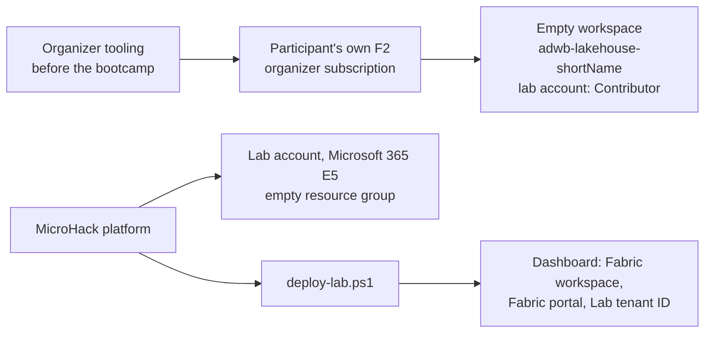

# Lab automation: dashboard entries for the participant's Fabric workspace

This folder makes the Zava Lakehouse Bootcamp deployable by the MicroHack platform. It follows the
[MicroHack lab automation contract](https://github.com/microsoft/MicroHack/blob/main/99-MicroHack-Template/labautomation/README.md)
and the shared bootcamp Fabric contract (v1) below. The platform publishes neither this folder nor
its files to participants or coaches.

The lab deploys nothing. Before the bootcamp, the organizer tooling in
[Natethebuilder/winter-bootcamp-fabric-capacities](https://github.com/Natethebuilder/winter-bootcamp-fabric-capacities)
gives every participant their own Fabric capacity and an empty workspace for this lab on it. This
folder only tells each participant, on their MicroHack dashboard, which workspace is theirs.
Challenge 1 then creates the lakehouse, uploads, notebooks and pipeline in that empty workspace.

| File | Purpose |
| --- | --- |
| `lab-defaults.json` | Platform settings: resource-group scope, 100 labs per subscription, license group, cost, quality and content preparation. |
| `deploy-lab.ps1` | Once per participant: derives the workspace name and emits the dashboard entries. Creates nothing. |

There is no `shared-deploy-lab.ps1`, Bicep template or OpenTofu module: there is nothing to share
or deploy.

## Shared bootcamp Fabric contract (v1)

The organizer tooling, the Foundations lab and this lab implement the same contract. Change it in
all of them together, never in one alone.

1. **Capacity.** One Fabric capacity per participant, shared by all of that participant's bootcamp
   labs. The organizer tooling creates it before the bootcamp from the participant list, in an
   organizer-owned resource group in a subscription in the lab tenant. The default SKU is F2.
   Participants get no Azure role on it and are not capacity administrators: they cannot resize,
   pause, resume or reconfigure it, or assign other workspaces to it.
2. **Running window.** The capacity is Active 08:00–16:00 CET (UTC+1) on the bootcamp Fridays:
   4, 11 and 18 December 2026, and 8, 15 and 22 January 2027. An automated schedule pauses it at
   all other times. A paused capacity outside that window is expected, not an error.
3. **Workspaces.** The organizer tooling creates one empty workspace per participant per lab on
   that participant's capacity, named `adwb-<labKey>-<shortName>`. This lab's `labKey` is
   `lakehouse`. `shortName` is the lab account's `ShortName` exactly as `Get-MhhLabUser` returns
   it: the lowercase local part of its UPN, unchanged. The lab account is Contributor on the
   workspace.
4. **Lab hooks.** `deploy-lab.ps1` creates no Azure or Fabric resources and makes no Fabric API
   calls. It computes the participant's workspace name and emits exactly the three dashboard
   entries below. It never fails because it cannot see the workspace.
5. **`lab-defaults.json`.** `deploymentType` `resourcegroup`, `groups` `["M365-E5-Users"]` (never
   `GHCPUsers`), `estimatedDailyCostsUsd` `1`, `estimatedSharedDeploymentDailyCostsUsd` `0` and
   `Quality` `Testing`.

## What happens for each participant



The platform creates the lab account, assigns the `M365-E5-Users` license group and creates an
empty resource group with the participant as its Owner and as Reader on the subscription. This lab
places nothing in it. `deploy-lab.ps1` then:

1. Validates its inputs in the script body. The param block matches the platform contract exactly.
2. Reads the lab tenant ID from `(Get-AzContext).Tenant.Id`.
3. Resolves the participant with `Get-MhhLabUser` and names the workspace
   `adwb-lakehouse-<ShortName>`, using `ShortName` unchanged. It warns, without failing, when
   `ShortName` is not the lowercase local part of the UPN, because the organizer tooling's name
   might then differ.
4. Emits the dashboard entries:

| Name | Value | Note |
| --- | --- | --- |
| `Fabric workspace` | `adwb-lakehouse-<shortName>` | Your empty workspace for this lab, on your own Fabric capacity. Available 08:00–16:00 CET on bootcamp Fridays. |
| `Fabric portal` | `https://app.fabric.microsoft.com` | Sign in with your lab account and open the workspace above. |
| `Lab tenant ID` | The lab tenant's ID | Use it with az login --tenant and your lab account. |

The script never looks the workspace up, so it cannot fail because the workspace is missing or the
capacity is paused. It fails, before emitting anything, only when it cannot resolve the lab
account or read the tenant ID. The platform runs it once per participant. If a lab ever lists
several participants, the single `Fabric workspace` entry lists each of their workspaces, because
re-emitting a credential name would overwrite it.

The platform adds its own entries, such as the lab account's sign-in details. The participant
content refers to the three names above, so keep them in sync if you rename one.

## `lab-defaults.json`

| Setting | Value | Why |
| --- | --- | --- |
| `deploymentType` | `resourcegroup` | Contract v1. The lab needs no subscription-scoped access. |
| `labsPerSubscription` | `100` | See below. |
| `groups` | `["M365-E5-Users"]` | Microsoft 365 E5, which includes Power BI Pro for the Challenge 6 semantic model. |
| `preferredLocation` | `swedencentral` | Only places each lab's empty resource group. The organizer tooling chooses the capacity region. |
| `estimatedDailyCostsUsd` | `1` | The capacity is billed in the organizer subscription, so labs cost nothing here. The platform treats values below 1 as 25. |
| `estimatedSharedDeploymentDailyCostsUsd` | `0` | No shared deployment. |
| `Quality` | `Testing` | Contract v1. The platform labels content from repositories other than `microsoft/MicroHack` Testing anyway. |
| `contentPreparation` | ZIP-download banners off | Participants work from a git clone, because Copilot needs `.github/`, `specs/`, `data/` and the scripts. |

**`labsPerSubscription` is 100, the schema maximum.** A lab's whole footprint in the pool
subscription is one empty resource group and two role assignments: Owner on the resource group and
Reader on the subscription. 100 labs use about a tenth of the 980 resource groups and a twentieth
of the 4,000 role assignments that Azure allows per subscription, and no compute or Fabric quota,
because the capacities live in the organizer subscription. Packing labs saves pool subscriptions
without changing the cost forecast, which charges nothing per subscription. A lower value only
spreads the same empty resource groups across more subscriptions.

## Prerequisites

### Organizer tooling

Run the [organizer tooling](https://github.com/Natethebuilder/winter-bootcamp-fabric-capacities)
before the bootcamp, in the tenant where the platform creates the lab accounts and for the same
participants. It creates each participant's capacity and their `adwb-lakehouse-<shortName>`
workspace, grants the lab account Contributor and schedules the running window. Its README covers
its own prerequisites, cost and cleanup. Every challenge assumes Fabric Runtime 2.0, the default
for new workspaces, so leave the workspace runtime at its default.

The default SKU is F2. If you choose F0 (on-demand billing, preview) instead, an organizer must
turn on Spark for each capacity: every challenge runs Spark notebooks.

### Fabric tenant settings

A Fabric administrator sets these in **OneLake catalog > Govern > Configurations > Tenant
settings**. Changes can take up to 15 minutes to apply.

| Setting | Enable for | Needed by |
| --- | --- | --- |
| **Users can create Fabric items** (Microsoft Fabric) | Lab users | Challenge 1: lakehouse, notebooks and pipeline |
| **Users can access data stored in OneLake with apps external to Fabric** (OneLake settings) | Lab users | Challenge 1 uploads the CSVs from the participant's machine through the OneLake APIs |

For the optional challenges:

- **Challenge 5, Project Osmos:** **Users can use Copilot and other features powered by Azure
  OpenAI**. **Users can use Copilot, AI Agents, and other AI experiences powered by OpenAI as a
  Microsoft Subprocessor** is recommended. If the capacity region has no OpenAI service, the
  cross-geo processing and storage settings are also needed. Challenge 5 also needs a second, fresh
  workspace on an active capacity, which neither this lab nor the contract provides: participants
  ask the instructor for one.
- **Challenge 6, semantic model and Fabric IQ:** the Fabric IQ MCP server needs a tenant home region
  that supports all Fabric workloads. Users must be able to consent to the delegated Power BI
  Service permissions `Item.Read.All` and `Item.Execute.All`; otherwise an administrator consents
  for them. The optional `powerbi-modeling-mcp` authoring route needs **Users can use the Power BI
  Model Context Protocol server endpoints (preview)**.

### Licenses

**`M365-E5-Users`** assigns Microsoft 365 E5, which includes Power BI Pro, to each lab user. The
lakehouse, notebooks and pipeline need only the free Fabric license. Power BI content, such as the
Challenge 6 semantic model, on a capacity smaller than F64 needs Pro. The platform adds the group's
license surcharge to the cost forecast.

### GitHub Copilot seats

Every challenge runs in GitHub Copilot CLI, so each participant needs a GitHub account with an
active Copilot seat. Organizers arrange these seats separately: `groups` has no Copilot group, so
the platform neither assigns a seat nor includes one in its cost forecast. Before the event:

- Give every participant a seat. Participants sign in to Copilot CLI with the GitHub account that
  holds it, and use their lab account only for `az login` and Fabric.
- Confirm that the policies of the organization or enterprise that owns the seats allow Copilot CLI
  and MCP servers. Challenge 6 adds the Fabric IQ MCP server.

## Running window

Capacities are Active 08:00–16:00 CET on the bootcamp Fridays and paused otherwise. The content
tells participants that a paused capacity outside that window is expected and that they cannot
resume it. Pre-work access checks therefore accept Paused, and setup stops and asks the instructor
only when the capacity is paused inside the window. Optional Challenges 5 and 6 also need an Active
capacity, so participants run them before 16:00 CET on a bootcamp Friday.

## Local testing

The hook deploys nothing, so a local run is free. Use the
[`adminpwsh`](https://github.com/qxsch/adminpwsh) image from this folder:

```powershell
docker run -it -v "${PWD}:/app" --rm "ghcr.io/qxsch/adminpwsh:latest"
```

Inside the container, sign in and run the hook with a lab user's object ID:

```powershell
Connect-AzAccount -UseDeviceAuthentication
cd /app
./deploy-lab.ps1 -DeploymentType resourcegroup -SubscriptionId (Get-AzContext).Subscription.Id `
    -ResourceGroupName 'not-used' -PreferredLocation swedencentral `
    -AllowedEntraUserIds '<object ID of a lab user>'
```

It prints three `HackboxCredential` hashtables. The container's `Get-MhhLabUser` is a local
stand-in for the platform version, so compare its `ShortName` with the organizer tooling's
participant list before trusting the name.

## Cleanup after the event

The platform deletes each lab's resource group, which is empty. The capacities and workspaces
belong to the organizer tooling, which keeps, pauses and removes them; see its README.

## Troubleshooting

| Symptom | Likely cause | Fix |
| --- | --- | --- |
| The dashboard's workspace does not exist in Fabric | The organizer tooling has not run for this participant, or derived another short name | Run the organizer tooling for the participant. Check the job log for the `ShortName` warning |
| Fabric reports the capacity as paused outside 08:00–16:00 CET on a bootcamp Friday | The schedule paused it, as intended | None |
| Fabric reports the capacity as paused inside that window | The schedule or a manual pause | An organizer resumes it through the organizer tooling |
| `Get-MhhLabUser did not resolve every participant` or an Entra lookup error | The platform could not resolve the lab account | Rerun the lab deployment |
| `No Az context with a tenant ID` | A local test without `Connect-AzAccount` | Sign in, then rerun |
| `ShortName ... is not the lowercase local part` warning | The UPN and `ShortName` differ | Make the organizer tooling use the same name, or rename the workspace |

## Validation status

`Quality` is `Testing`. The hook parses, passes PSScriptAnalyzer and matches the documented
parameter block. Offline runs against simulated platform helpers cover the three entries and their
exact text, unchanged short names, several participants and the failure cases, and confirm that it
makes no Azure or Fabric call. Run a pilot before relying on it: the organizer tooling, tenant
settings, licenses and dashboard have not yet been proven together.
